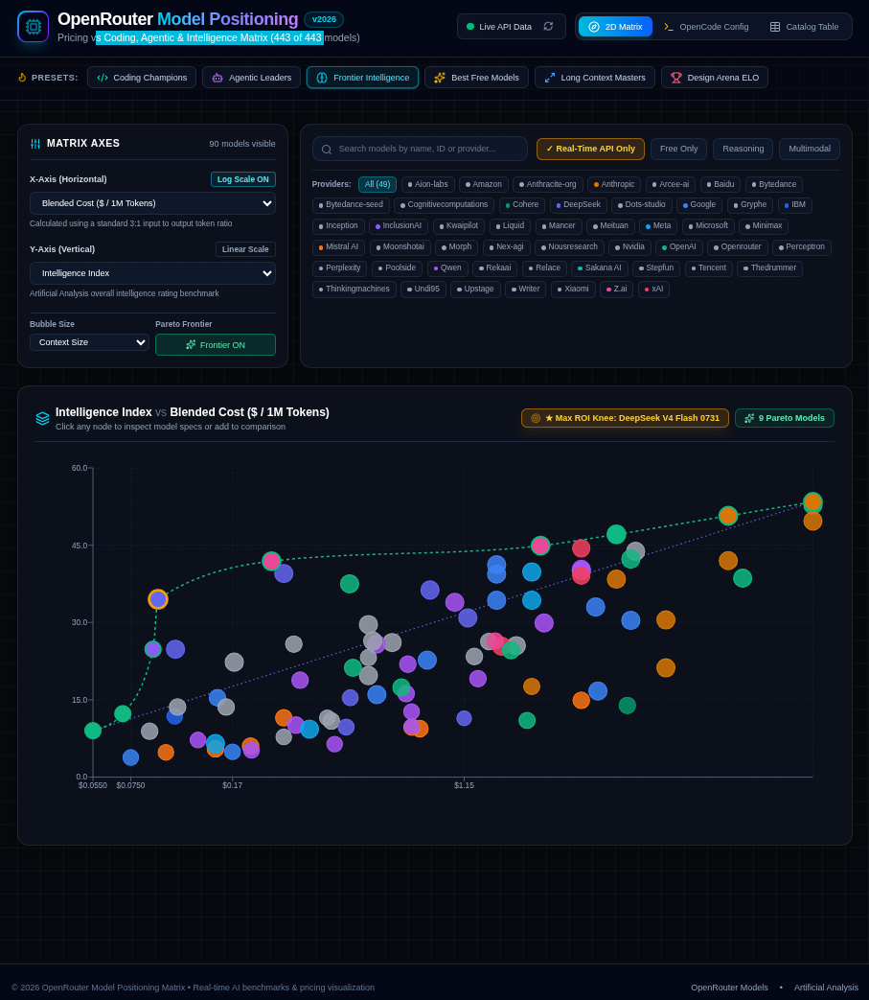

# OpenRouter Model Chooser 🚀

> **An interactive matrix of LLM price vs. performance that finds the good-value models mathematically and turns them into a cost-aware OpenCode configuration.**
>
> ⚡ *This project was vibe coded with AI.*

---

## 📸 Preview



---

## 🎯 Overview

[OpenRouter](https://openrouter.ai/models) lists 400+ models, and the price spread between them is huge — the most expensive cost hundreds of times more than the cheapest. **OpenRouter Model Chooser** plots every model's capability against its real API price, marks which models are worth their price, and generates an [OpenCode](https://opencode.ai) setup in which cheap models do the everyday work and expensive ones are an explicit, visible choice.

Model data is fetched live from OpenRouter on every load (a bundled snapshot is the offline fallback), so the picks follow the market.

---

## 🌟 Features

- 📊 **2D Matrix** — blended cost (`(3×prompt + completion) / 4` per 1M tokens, log scale) against Intelligence, Coding or Agentic Index, Text-to-Image ELO, Design Arena ELO or context window.
- 📐 **Picks computed on the Pareto frontier:**
  - **Best Budget Knee** — the elbow of the cheap end (Kneedle algorithm): most capability per dollar.
  - **Value Recovery** — the first model above the knee where paying more buys meaningful capability again. The badge shows what it buys over the knee (points gained, cost multiple, points per cost doubling).
- 📖 **Methodology tab** — every formula, the alternatives that were tried and rejected, and the references behind them.
- 🔍 **Catalog Table** — search, provider filters, free/reasoning/multimodal toggles, CSV export.
- ⚙️ **OpenCode Config generator** — see below.

Batch-only (`:batch`) prices are excluded so the numbers reflect interactive use. Text-to-Image only counts models OpenRouter's Image API can actually run.

---

## 🚀 Quick Start

**Container** (no local toolchain besides `make`, Node and podman/docker):

```bash
make container   # build the app and the image
make run         # http://localhost:8080 — mounts ./.opencode for "Write on disk"
make stop
```

**Development:**

```bash
npm install
npm run dev      # Vite dev server, "Write on disk" included
npm run build    # type-check + production build
npx oxlint       # lint
```

---

## ⚙️ OpenCode Integration

The **OpenCode Config** tab generates a configuration for **OpenCode 2.x** (tested with 2.0.32) from the current picks.

**What you get**

- **Cheap defaults.** `build`, `plan`, the `general` and `explore` subagents and title generation all use the Budget Knee model, so everyday work — including switching between `plan` and `build` — never touches an expensive model.
- **Expensive models are opt-in and labelled:**
  - the `build-premium` agent (Coding Value pick) — switch to it with **Shift+Tab**;
  - `/deep <question>` — one question to the Intelligence Value pick;
  - in `/model`, recommended models are named with their price and cost multiple: `[✔]` Budget Knee (default), `[$$]` other recommended, `[$$$]` recommended but $5/M or more. Expensive models on no Pareto frontier are hidden.
- **Image generation.** OpenCode can't generate images by itself, so the config comes with a plugin, `plugins/image-generation.js`, which adds an `image_generate` tool calling OpenRouter's Image API (tiers *budget* and *best*). Ask `build` for an image — or for something that needs one — or use `/image [budget|best] <description> → <path>`. OpenCode asks for approval before every paid image; the tool reports the saved path and the cost.

**Install for one project.** Click **Write on disk** (dev server or container), or download the zip and unzip it in the project root. Either way you get:

```
.opencode/opencode.jsonc                ← the config; OpenCode reads it from here
.opencode/plugins/image-generation.js   ← the plugin; loaded automatically
```

Put your OpenRouter token in `.openrouter-token` in the project root (keep it out of git). OpenCode and the plugin both read it; the generated permissions deny agents access to it.

**Install user-wide.** Run `make install` (or `./setup-user-config` from the zip). It merges the generated config into `~/.config/opencode/opencode.jsonc` and copies the plugin to `~/.config/opencode/plugins/`. Your own settings are kept, every line it adds is tagged `// @ormc`, and re-running it replaces exactly those lines; a timestamped backup is written first. Comments in your existing config are not preserved, the backup keeps them. Needs `python3`. User-wide token: `~/.config/opencode/.openrouter-token`.

Then run `opencode service restart`.

To write into another project from the container: `make run OPENCODE_DIR=/path/to/project/.opencode`.

---

## 🤖 Vibe Coded

This application was built through conversational AI pair programming. It was started with **Google Antigravity** — the design system, the Pareto analysis and chart overlays, the container and the first OpenCode integration — and was later reworked and extended with **Claude Code** and **OpenCode**: among others, the Value Recovery significance gate, the OpenCode 2.0 configuration with cost labels, the image-generation plugin, "Write on disk" and the user-wide install script.

---

## 📄 License

[MIT](LICENSE) © 2026
